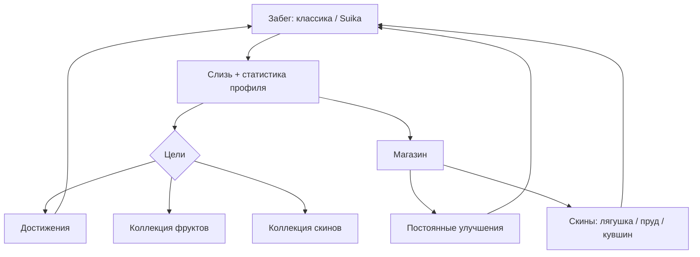

# Мета-прогрессия и развитие

← [Назад к README](../README.md)

Документ описывает **постоянный слой поверх забега**: валюту, скины, постоянные улучшения и цели.
Сейчас игра «конечна» — рекорд классики, рекорд Suika и запас фруктов. Мета-прогрессия даёт игроку
причину возвращаться: что-то копить, открывать и улучшать.

Раздел носит характер **стратегии и дорожной карты**: описывает целевую архитектуру и порядок работ.
Реализованные части помечаются по мере появления кода.

## Что уже реализовано

**Фаза 0: фундамент мета-прогрессии.** В главном меню есть **«Профиль»** (сразу под кнопкой
«Мини-игра: Suika») — экран с постоянной статистикой (рекорды классики и Suika, запас фруктов,
партии, пойманные и золотые фрукты, слияния Suika) и балансом валюты **«Слизь»**. Баланс виден
бейджем в меню и растёт за забеги и раунды Suika. Данные лежат в `user://save.cfg`, секция `meta`
(см. [SYSTEMS.md](SYSTEMS.md)). Код: `Game/Meta/` (`MetaStats`, `Wallet`, `SlimeReward`,
`MetaProfile`, `MetaSave`) и `Game/UI/Meta/` (`ProfilePanel`, `WalletBadge`).
Скины и постоянные улучшения ещё не реализованы.

## Принципы

- **Не ломать баланс забега.** Постоянные бонусы небольшие и с верхним пределом, применяются только в
  уже существующих точках (`MaxLives`, `ResetMainRoundData`, спавн предметов).
- **Логика — чистыми C#-моделями** без привязки к Godot-нодам (как `XpSystem`, `Difficulty`,
  `PerkEffects`), чтобы её было легко тестировать и расширять.
- **Данные — каталогами** (как `FruitCatalog`, `PerkCatalog`, `SubPerkCatalog`): новый скин, улучшение
  или достижение добавляется записью в каталог, а не правкой механики.
- **Файлы меньше 700 строк**, функциональность разнесена по связанным файлам.
- **Обратная совместимость сохранений**: чтение старых `save.cfg` сохраняется, неизвестные id
  игнорируются.

## Игровой цикл

```
Играю забег (классика / Suika)
   │  зарабатываю «Слизь» + растёт статистика профиля
   ▼
Открываю цели: достижения · коллекция фруктов · коллекция скинов
   │  трачу «Слизь»
   ▼
Магазин: постоянные Улучшения  +  Скины (лягушка / пруд / кувшин)
   │  новый билд и внешний вид
   ▼
Снова играю: новые цели (ежедневные задания, «собери 100 %»)
```



Четыре опоры удержания: **Прогрессия** (постоянные улучшения), **Коллекция** (скины и альбом
фруктов), **Разнообразие** (внешний вид), **Краткосрочные цели** (достижения и ежедневные задания).

## Слои систем

Новая функциональность размещается в двух папках, чтобы не раздувать существующие файлы
(`Main.cs` уже больше 800 строк — там только хуки по 2–3 строки).

### `Game/Meta/` — постоянная логика (C#, тестируемо)

| Файл | Назначение |
|---|---|
| `Wallet.cs` | баланс валюты «Слизь»: начислить/списать, событие `Changed` |
| `MetaStats.cs` | пожизненная статистика: забегов, поймано, лучший счёт, слияний Suika, по видам фруктов |
| `MetaProfile.cs` | агрегат постоянного состояния: кошелёк, статистика, уровни улучшений, скины, достижения |
| `MetaSave.cs` | загрузка/запись профиля в `user://save.cfg` (секция `meta`) |
| `MetaProgression.cs` | уровень профиля и награды за общий опыт профиля |
| `UpgradeDefinition.cs` | `UpgradeId` и описание постоянного улучшения |
| `UpgradeCatalog.cs` | каталог улучшений: данные, цена, иконка |
| `MetaUpgradeEffects.cs` | числовая механика улучшений (чистые функции) |
| `SkinDefinition.cs` | `SkinId`, тип скина, палитра, цена и условие открытия |
| `SkinCatalog.cs` | каталог скинов: данные и загрузка превью |
| `SkinUnlockRules.cs` | правила открытия: пороги счёта и счётчики статистики |
| `AchievementDefinition.cs` | `AchievementId` и описание достижения |
| `AchievementCatalog.cs` | каталог достижений (данные) |
| `AchievementTracker.cs` | проверка выполнения и выдача наград по статистике |
| `DailyQuests.cs` | ежедневные задания: выбор по дате, прогресс, награда (Фаза 3) |

### `Game/UI/Meta/` — экраны (в стиле игры)

| Файл | Назначение |
|---|---|
| `MetaMenu.cs` | экран «Профиль»: вкладки Улучшения / Скины / Достижения, баланс слизи и уровень |
| `WalletBadge.cs` | счётчик слизи в меню |
| `UpgradeCard.cs` | карточка улучшения: иконка, описание, цена, уровень |
| `UpgradeShopPanel.cs` | список покупки улучшений |
| `SkinCard.cs` | карточка скина: превью, цена/условие, «Выбрать»/«Купить»/«Закрыто» |
| `SkinGalleryPanel.cs` | галерея скинов по типам |
| `AchievementRow.cs` | строка достижения с прогрессом |
| `AchievementPanel.cs` | список достижений |
| `QuestPanel.cs` | ежедневные задания (Фаза 3) |

Экраны используют общий стиль (`Game/UI/Stickers/`, `UiStyle`, `ModalContent`) и локализацию
(`LocKeys` / `LocText`), поэтому визуально совпадают с меню, карточками перков и Suika.

## Точки интеграции в текущий код

| Место | Правка |
|---|---|
| `HUD.BuildStart()` | кнопка «Профиль» и событие `MetaPressed` |
| `HUD` | метод `SetWallet(int)` для бейджа слизи |
| `Main._Ready()` | загрузка `MetaProfile`, применение выбранных скинов (пруд/лягушка/кувшин) |
| `Main.StartGame()` / `Restart()` / `ResetMainRoundData()` | бонусы постоянных улучшений через существующие точки (стартовые HP, XP, множитель очков, шанс золотого) |
| `Main.GameOver()` | начисление слизи, обновление `MetaStats`, проверка достижений, сохранение профиля |
| `Main.RegisterCollectedFruit()` и слияние Suika | счётчики статистики |
| `Frog` | метод `ApplySkin(FrogSkin)` (палитра → `Modulate`/константы, позже — путь к спрайт-сету) |
| `PondBackdrop` / `MenuBackground` / `SuikaBackdrop` / `SuikaBowlView` | приём палитры из выбранного скина |

## Экономика

**Валюта — «Слизь» / «Slime»**: единый ресурс мета-прогрессии, копится между партиями и
перезапусками, тратится на скины и постоянные улучшения. Отделена от запаса фруктов: фрукты
остаются ресурсом Suika, слизь — ресурсом развития.

### Источники

| Источник | Начисление |
|---|---|
| Классический забег | `счёт / 1000` + `поймано фруктов / 50` |
| Новый рекорд классики | +10 |
| Suika | `слияния / 5` + `очки / 100` |
| Достижение | 5…40 (зависит от сложности) |
| Ежедневное задание | 5…15 |

### Стоки

| Товар | Цена |
|---|---|
| Скин | 30…150 (либо открывается за достижение — без траты) |
| Улучшение уровня `L → L+1` | `20 × (1 + 0,6 × L)` |

### Постоянные улучшения (небольшие, с верхним пределом)

| Улучшение | Эффект | Кап | Где применяется |
|---|---|---|---|
| Запас сил | +1 стартовое HP | +1 | `ResetMainRoundData` |
| Меткость | +5…15 % к очкам за фрукт | +15 % | начисление очков в `PerkPlayer` |
| Чутьё | +1…5 % шанс золотого фрукта | +5 % | `SpawnItem` |
| Хватка | +5…20 % слизи за забег | +20 % | `Main.GameOver` |

Значения и цены — стартовая отправная точка; баланс правится в каталогах (`UpgradeCatalog`,
`SkinCatalog`), без правки механики.

## Скины

Три типа скинов, все применяются мгновенно после выбора и сохраняются:

- **Лягушка** — палитра тела и рук (`Frog`).
- **Пруд** — палитра воды и декора (`PondBackdrop`, `PondDecor`, `MenuBackground`, `SuikaBackdrop`).
- **Кувшин** — палитра стекла (`SuikaBowlView`).

На старте — **палитровые скины** (перекраска существующего арта, без новых файлов). Описание скина
предусматривает и подключение спрайт-сетов (`assets/frogs/{skin}/…`) в отдельной фазе, поэтому
переход на полный арт не потребует переделки магазина.

Открытие — двумя путями (совместимо): **покупка за слизь** и **открытие за достижение**
(например, «Дойди до 1000 очков» → скин).

## Схема сохранения

Новая секция `meta` в `user://save.cfg` (в стиле существующей `collection`: списки `Id:Value,...`):

| Ключ | Значение |
|---|---|
| `meta` / `coins` | баланс слизи |
| `meta` / `profile_level` | уровень профиля |
| `meta` / `upgrades` | `UpgradeId:Level,...` |
| `meta` / `skins` | список открытых `SkinId,...` |
| `meta` / `skin_frog` / `skin_pond` / `skin_bowl` | выбранные скины |
| `meta` / `achievements` | список выполненных `Id,...` |
| `meta` / `stats` | `runs:…,caught:…,golden:…,merges:…` (рекорды остаются в `score/high` и `suika/high`) |
| `meta` / `daily` | `date`, `progress`, `taken` (Фаза 3) |

Старые сохранения читаются как есть; отсутствующие ключи `meta` берут значения по умолчанию.

## Дорожная карта

| Фаза | Что делаем | Результат |
|---|---|---|
| **0. Фундамент** | `Wallet`, `MetaStats`, `MetaProfile`, `MetaSave`; начисление слизи и статистика в `Main`; бейдж слизи и кнопка «Профиль»; пустой экран профиля | валюта копится, статистика ведётся, есть куда зайти _(сделано)_ |
| **1. Скины** | `SkinCatalog`, галерея с превью, покупка/выбор, `SkinUnlockRules`, применение скинов, коллекция фруктов | «открытие скинов» — видимый результат |
| **2. Улучшения** | `UpgradeCatalog`, `MetaUpgradeEffects`, магазин с растущей ценой, применение бонусов, уровень профиля | постоянная прокачка |
| **3. Цели** | достижения, ежедневные задания, награды-скины за достижения, итог забега с прогрессом целей | повод заходить каждый день |
| **4. Полировка** | завершение коллекций, «престиж»/бесконечный режим, витрины-счётчики | глубина на длинную дистанцию |

Каждая фаза — отдельный инкремент со своими файлами, тестами и обновлением документации.

## Тесты и документация

Планируемые headless-проверки (по образцу существующих в `Tests/`, без порчи `save.cfg`):

| Проверка | Что проверяет |
|---|---|
| `MetaSaveChecks` | сохранение/чтение профиля, обратная совместимость, неизвестные id |
| `WalletChecks` | начисление и списание слизи, границы |
| `SkinUnlockChecks` | правила открытия, выбор и применение скина |
| `MetaUpgradeEffectsChecks` | числа бонусов улучшений и их пределы |
| `AchievementChecks` | выполнение условий и выдача наград |

При реализации фаз обновляются: `README.md`, `docs/SYSTEMS.md` (секция `meta`),
`docs/ARCHITECTURE.md` (папки `Meta/`, `UI/Meta/` и «как добавить скин/улучшение/достижение»),
`docs/GAMEPLAY.md` (что даётся за забег), `docs/UI.md` (новые экраны), `docs/TESTS.md`.

## Риски и компромиссы

- **Баланс.** Постоянные бонусы легко «сломать» игру — держим их небольшими и с верхним пределом,
  применяем только в существующих точках; при желании базовую сложность слегка повышаем с ростом
  уровня профиля, чтобы прогресс не отменял вызов.
- **Скины без нового арта** (палитра) дешёвы и быстры, но менее выразительны; полный арт — отдельная
  фаза и не требует переделки магазина.
- **Рост `Main.cs`.** Вся тяжёлая логика уходит в `Game/Meta/`; в `Main` — только хуки.
- **Нет центрального менеджера сохранения.** Секции `save.cfg` пишут разные системы; риск
  дублирования `ConfigFile` закрывается либо аккуратным `MetaSave`, либо (опционально) общим
  хелпером `Game/Core/SaveFile.cs`.

---

← [Назад к README](../README.md)
